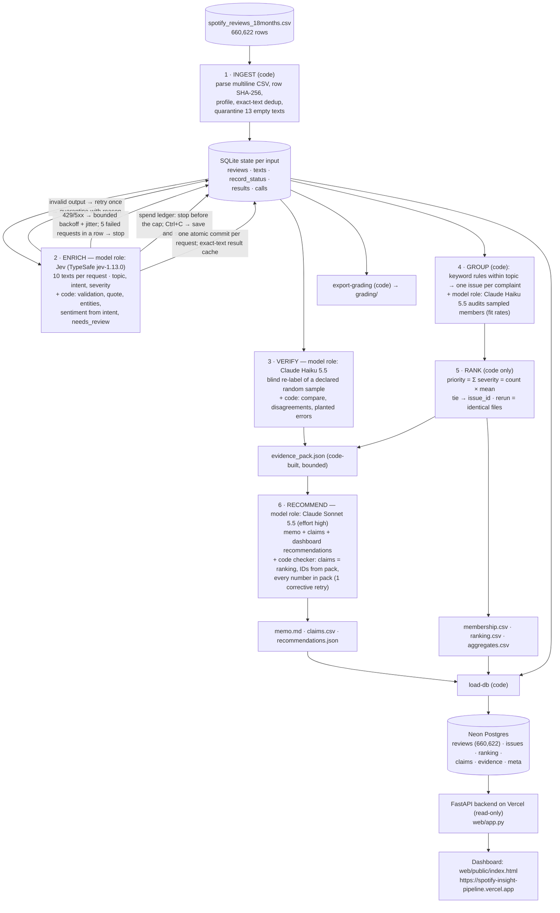

# Spotify Review Insight Pipeline

Haas MBA 290T1 (Fundamentals of Agentic AI) — final assignment. A code-orchestrated, multi-role pipeline that
classifies **all 660,622 Spotify Google Play reviews** (May 2022 – Nov 2023), groups complaints into issues, ranks
them, and writes a decision memo answering: *where should next quarter's product effort go — access, usability,
playback, or billing/support?*

| | |
|---|---|
| **Live dashboard** | **https://spotify-insight-pipeline.vercel.app** — public, no login. The first load of the trend chart can take ~2 s (computed live over all 660k rows in the database). |
| Backend API (same site) | `/api/health`, `/api/summary`, `/api/areas`, `/api/trend`, `/api/ranking?kind=baseline\|actionable\|without_needs_review`, `/api/appendix` (memo appendix tables A and B), `/api/issues/{issue_id}`, `/api/recommendations`; docs at `/api/docs` |
| Decision memo | [`memo.md`](memo.md) (memo-v5: playback + usability under the leadership direction in [`config/decision_criteria.yaml`](config/decision_criteria.yaml); baseline ranking basis and every non-ranking number sourced to the evidence pack; earlier versions kept: [`memo_v1.md`](runs/analysis/spotify_reviews_18months/memo_v1.md), [`memo_v2.md`](runs/analysis/spotify_reviews_18months/memo_v2.md), [`memo_v3.md`](runs/analysis/spotify_reviews_18months/memo_v3.md), [`memo_v4a.md`](runs/analysis/spotify_reviews_18months/memo_v4a.md), [`memo_v4.md`](runs/analysis/spotify_reviews_18months/memo_v4.md)) |
| Grading export | [`grading/`](grading/) — course self-check `check_submission.py`: **status pass, no issues** |
| Cost calculator | [`cost/`](cost/) — `python cost/calculator.py` (offline replay, default) · report: [`cost/report.md`](cost/report.md) · provider reconciliation: [`cost/reconciliation.md`](cost/reconciliation.md) |
| Project log | [`LOG.md`](LOG.md) — every step, decision, experiment, bug and cost, in order · plan and checklist: [`Plan.md`](Plan.md) · run manifest: [`runs/final_run_manifest.json`](runs/final_run_manifest.json) |
| Labels and schema | [`docs/label_examples.md`](docs/label_examples.md) (worked examples) · [`docs/schema.md`](docs/schema.md) (output schema) |
| Large files | GitHub release [**v1.1**](https://github.com/vmilare/spotify-insight-pipeline/releases/tag/v1.1) (full enriched records with model confidences; `grading_export.zip` = current `grading/`). v1.0 (2026-10-12) is kept but its grading zip predates memo-v4/v5 |

---

## 1. Results summary

**Measured (full run):**

| Item | Result |
|---|---|
| Source rows ingested / accounted for | **660,622 / 660,622** (profile identical to the course helper; all manifest checks pass) |
| Classified (completed) | **660,609 of 660,609 nonempty (100%)** · 0 pending |
| Quarantined | **13** — `empty_review_text` |
| Exact-text reuse | 484,189 distinct texts; **176,420** reviews reuse the saved labels of an identical text (`cache_source_id`), each kept and counted separately |
| Complaint + cancellation records (ranking base) | **290,720** (26,312 express cancellation intent) |
| Flagged `needs_review` | 210,531 records (31.9% of completed) — low Jev confidence or likely non-English |
| Golden set (50 human labels, held out) | topic **35/50**, intent **45/50**, severity exact **36/50** (±1: 49/50), sentiment MAE 0.31 |
| Independent verifier (blind, random 500) | topic **413/500**, intent **462/500**, severity exact **378/500**; planted-error test **96/100** caught |
| Model calls in the grading log | **48,452** logged attempts, **0 failed** ([`grading/calls.jsonl.gz`](grading/calls.jsonl.gz)) |
| Enrichment wall clock (full file) | 62.6 min over 3 runs (29.2 + 1.0 interrupted + 32.4), 2 workers, ~118–137 texts/s |
| API spend, whole project | **$10.90** of an $11 cap (full-file Jev enrichment **$9.41**) — [`runs/spend_ledger.csv`](runs/spend_ledger.csv) |

**Estimated before the run vs actual:** the calculator projected $9.79 (base) / $10.63 (conservative) for the full run;
actual full-file enrichment was $9.41, plus $0.17 of development runs whose results were reused (470.9 tokens/text vs
468.4 projected). Accounted-for rows (660,622) and completed classifications (660,609) are reported separately everywhere.

**Recommendation (memo-v5, [`memo.md`](memo.md)):** fund **playback (incl. downloads) first and usability second** —
PLY-WONTPLAY (priority 58,604 [C3]), PLY-GENERAL (46,627 [C6]) and PLY-CRASH; USA-ADS (87,029 [C7]) and USA-REDESIGN
(34,446 [C9]). This scope is a **leadership decision**, recorded in [`config/decision_criteria.yaml`](config/decision_criteria.yaml):
fund what the product team controls (the ad experience counts as product work); pricing, plan structure and billing
contracts go to leadership. It is not what the data alone ranks first: the top actionable issue is BIL-PAYWALL
(baseline rank 2 behind OTH-GENERAL, 85,894 complaints [C1], priority 180,521 [C2]; BIL-PAYWALL priority 118,521
[C10]), and billing/support complaints rose to **13.5% (Sep), 26.3% (Oct), 19.7% (Nov 2023, partial)** of monthly
reviews. The memo says so; product-side entitlement defects (paid features not working) stay on a product list.
Why the scope is defensible: over the full period playback (incl. downloads, severity sum 193,130, mean 3.37) and
usability (174,227) are the two largest specific areas, ahead of billing/support (154,065).

**Read this with the sensitivity findings** (all in the saved data, disclosed in the memo): over the full period the area
roll-up ranks playback first and billing/support third; excluding needs_review records puts ads ahead of the paywall; the
playback issues have the weakest verifier agreement. The recommendation changed as evidence was added to the memo's
evidence pack — billing (500-review development sample) → playback (full data, memo-v1) → usability (+ per-issue
verification, memo-v2) → billing/support (+ monthly trend, memo-v3; memo-v4 kept the answer and added the baseline
ranking basis and sourced quantities) → playback + usability (memo-v5, leadership direction). Each version is kept and the reason for each
regeneration is in [`LOG.md`](LOG.md); the top areas are close and the answer depends on label reliability and timing.

---

## 2. Architecture

Six stages coordinated by code (`python -m pipeline …`). Code owns record accounting, validation, caching, budgets,
retries, arithmetic and checks; models are used only where language judgment is needed.



| Stage | Owner | Input → output | Failure behavior / stop condition | Why a model (or not) |
|---|---|---|---|---|
| 1 Ingest | code ([`pipeline/ingest.py`](pipeline/ingest.py)) | CSV → state DB, [`ingestion_report.json`](runs/ingest/spotify_reviews_18months/ingestion_report.json), [`grading/ingestion.json`](grading/ingestion.json) | Fails loudly on malformed CSV; empty text → quarantine `empty_review_text` | Counting, hashing and dedup need no model |
| 2 Enrich | Jev + code ([`pipeline/enrich.py`](pipeline/enrich.py), [`pipeline/jev.py`](pipeline/jev.py), [`pipeline/extract.py`](pipeline/extract.py)) | pending distinct texts → validated records | Invalid → 1 retry → quarantine; HTTP errors → 3 attempts with backoff; 5 consecutive failed requests → stop; budget cap → stop; Ctrl+C → finish in-flight, save, stop; restart dispatches only pending texts | Topic, intent and severity need language judgment; Jev answers fixed-choice questions with probabilities. Quote, entities, sentiment mapping and flags are code |
| 3 Verify | Claude Haiku 5.5 + code ([`pipeline/verify.py`](pipeline/verify.py)) | random sample (500) → [`verify_report.json`](runs/analysis/spotify_reviews_18months/verify/verify_report.json), [`disagreements.csv`](runs/analysis/spotify_reviews_18months/verify/disagreements.csv) | Unknown/missing keys ignored and counted; bounded retries | An independent reader of the same text; code does the comparison |
| 4 Group | code + Claude Haiku 5.5 ([`pipeline/group.py`](pipeline/group.py), [`pipeline/group_review.py`](pipeline/group_review.py)) | records + [`config/issues.yaml`](config/issues.yaml) → [`membership.csv`](runs/analysis/spotify_reviews_18months/membership.csv), [`issue_review.csv`](runs/analysis/spotify_reviews_18months/issue_review.csv) | Every complaint lands in exactly one issue (catch-all per topic) | Membership must be reproducible → code. The model names issues and audits a bounded sample; it never changes membership |
| 5 Rank | code ([`pipeline/rank.py`](pipeline/rank.py)) | membership + records → [`ranking.csv`](runs/analysis/spotify_reviews_18months/ranking.csv), [`ranking_actionable.csv`](runs/analysis/spotify_reviews_18months/ranking_actionable.csv), [`ranking_without_needs_review.csv`](runs/analysis/spotify_reviews_18months/ranking_without_needs_review.csv), [`ranking_topics.csv`](runs/analysis/spotify_reviews_18months/ranking_topics.csv), [`aggregates.csv`](runs/analysis/spotify_reviews_18months/aggregates.csv) | Deterministic | Arithmetic is code's job |
| 6 Recommend | Claude Sonnet 5.5 + code ([`pipeline/recommend.py`](pipeline/recommend.py)) | [`evidence_pack.json`](runs/analysis/spotify_reviews_18months/evidence_pack.json) → [`memo.md`](memo.md), [`claims.csv`](grading/claims.csv), [`recommendations.json`](runs/analysis/spotify_reviews_18months/recommendations.json) | Checker rejects unknown issue IDs, claim values ≠ ranking, a missing baseline rank-1 claim, review IDs not in the pack, any prose number not backed by a claim or an `other_quantities` entry whose pack path resolves to that value → 1 corrective retry → marked failed | Writing an argument needs a model; it reads only saved aggregates and ≤3 quotes per top issue, never the raw dataset |

Distinct roles = separate instructions ([`prompts/`](prompts/), [`config/labels.yaml`](config/labels.yaml)), inputs, outputs and saved
evidence. Every model attempt is logged (request ID, role, model, label_config, review IDs sent, usage, outcome, phase);
SDK auto-retries are disabled so retries are visible. Review text is treated as data (prompt-injection defense, tested).
Where code chooses the next step: pending-work selection, cache reuse, retry/quarantine, budget admission, breaker,
issue assignment, ranking, evidence-pack contents, claim checks. Where a model exercises judgment: Jev's labels,
the verifier's labels, issue names/fit audit, and the memo's argument.

**Exact models and settings** (dated rates in [`cost/rates.csv`](cost/rates.csv)):
- Enrich: `jev-1.13.0` (TypeSafe `/v1/systemone`), question set `jev-q-tiny-v1` ([`prompts/jev_tiny_v1.yaml`](prompts/jev_tiny_v1.yaml)),
  10 reviews per request, `label_config = jev-1.13.0+jev-q-tiny-v1-pack10+schema-v1+quote-v1+sent-from-intent-v1`.
- Verify and group review: `claude-haiku-5-5`, effort low, thinking off, JSON-schema structured output.
- Memo: `claude-sonnet-5-5`, effort high, adaptive thinking, server-side `fallbacks: "default"`; prompt `memo-v5` ([`prompts/memo_v5.md`](prompts/memo_v5.md)).

---

## 3. One review traced end to end

Review **`4b5220da-4c26-4a20-aff8-d5caab56255a`** (row 206,953, 2022-12-13, app 8.7.90.544, 2 stars):

> "Please fix the glitches that keep happening. This is my favorite music app please don't make me find something else.
> The music stops randomly and when you jump back on the music player disappears when you get back on the app to start the music."

| Step | Evidence |
|---|---|
| Source | `source_sha256 = 5c4b13358879e394eb30d9729dd228eda53aee619ac0cccfe4024fbe5a240a3f` (course `row_sha` over the six original fields) |
| Enrichment | Jev request `jev-69309fb960ff4512` (run `…20261012T083441342`, phase `resume`, 10 reviews, 4,763 input tokens, succeeded) → topic **playback** (p=0.99), intent **complaint** (p=0.79), severity **3** (p=0.78), sentiment −0.49 (computed from intent probabilities), quote = the "The music stops randomly…" sentence (exact substring), `needs_review=false` |
| Verification | In the random verify sample: Haiku 5.5, blind → playback / complaint / 3 / −0.5 — agrees |
| Issue membership | Playback rules are checked in order; "glitch" matches **PLY-WONTPLAY** before "stop" (PLY-STOPS) is reached — it arguably fits both, a visible example of the keyword-order limitation ([`membership.csv`](runs/analysis/spotify_reviews_18months/membership.csv)) |
| Ranking | PLY-WONTPLAY: baseline rank 4, 16,888 complaints, severity sum 58,604, mean 3.470156 |
| Memo claim | memo-v5 **[C3]** `PLY-WONTPLAY priority_score 58604` and **[C5]** mean severity 3.470156 (the lead playback issue) — checked against `ranking.csv` (✓ chips on the dashboard) |

**A failed / ambiguous case and its handling.** Golden review `46c0b49f…`: *"Listening to music in a normal volume and
suddenly an add starts and my ears feel like they explode!!"*. Human label: playback / complaint / 2 (labeler note: the
complaint is about the ad's volume). Jev: usability / complaint / 3, topic confidence 0.60, severity confidence 0.36 →
**flagged `needs_review` (`low_confidence_severity`)**, kept in USA-ADS. Recorded decision: keep the model label and the
flag, exclude it in the sensitivity ranking that drops flagged records, and report it in the golden error analysis (the
contract puts ad interruptions in usability, so this is a genuinely ambiguous boundary). Hard failures are handled by
status: the 13 empty texts are quarantined with `empty_review_text`; the malformed-output test shows a review retried
once and then quarantined with `invalid_model_output: topic not allowed` ([§5](#5-system-tests)).

---

## 4. Labels and the golden-set evaluation

- Shared definitions: [`config/labels.yaml`](config/labels.yaml) (the contract's 8 topics, 5 intents with precedence, severity 1–5,
  sentiment, entities, evidence quote, needs_review); worked examples: [`docs/label_examples.md`](docs/label_examples.md); output schema:
  [`docs/schema.md`](docs/schema.md).
- **Dev set** (50 reviews from `analysis_10000.csv` rows 501–10,000, labeled by the author): used to choose the Jev
  question set, the sentiment mapping and the needs_review threshold ([`evals/dev_50_labeled.csv`](evals/dev_50_labeled.csv)).
  Experiments: [`evals/results/dev_compare/summary.md`](evals/results/dev_compare/summary.md), [`dev_compare_b/summary.md`](evals/results/dev_compare_b/summary.md).
- **Golden set** (course `golden_50_to_label.csv`, labeled by the author from scratch, [`evals/golden_50_labeled.csv`](evals/golden_50_labeled.csv)):
  never used in prompts, question text, thresholds or the sentiment mapping; evaluated once with the frozen setup; the
  results did not change the setup. Results: [`evals/results/golden/summary.md`](evals/results/golden/summary.md) (confusion tables,
  disagreement list) and [`per_case.csv`](evals/results/golden/per_case.csv) (expected, predicted, pass/fail per field).

| Metric (n = 50) | Result |
|---|---|
| Topic agreement | 35/50 |
| Intent agreement | 45/50 |
| Severity exact / within ±1 / MAE | 36/50 / 49/50 / 0.30 |
| Sentiment MAE / within predeclared ±0.5 | 0.31 / 46/50 |
| Evidence quote is an exact substring | 50/50 (whole text for 46) |
| Quote supports the label (inspected) | the 4 sentence-level quotes were read: 3 support topic and intent; 1 (`3ddb3f4e`) supports the topic but the cancellation cue ("Deleting this App") lies outside the quoted sentence |
| Entities not present in the text | 0 |
| Missing or quarantined predictions | 0 |
| Ambiguous cases | 0 flagged by the labeler; 11 carry labeler notes (unclear / unsupported language / boycott) |
| needs_review as a predictor | 7 of 11 flagged had a topic/intent error vs 10 of 39 unflagged; catches 7 of 17 errors |

**Error analysis (themes in the 24 disagreements):** (1) ad reviews — human billing/playback vs Jev usability (the
contract puts ad interruptions in usability); (2) "app won't open / crashes" — human access vs Jev playback (contract:
crashes are playback); (3) generic "hate this app" — human severity 1 vs Jev 2 (contract: generic criticism = 2), 6 cases;
(4) short non-English texts — human unclear vs Jev guessed a topic (2 of 3 flagged); one, "Please ye ads ko thoda kumm
Karo…" (Hindi: "please reduce the ads a bit"), Jev's usability/request is arguably right; (5) praise topics (general
praise is `other` per contract); (6) Jev rates some billing/usability complaints one level more severe. Several
disagreements are cases where the human label departs from the written rule (the course allows multiple accepted
labels for ambiguous cases). Fifty cases are a diagnostic sample, not a population accuracy estimate.

**Dev-set note:** 10 dev reviews were labeled severity 5 (8 of them cancellations over ads/paywalls), while the contract
reserves 5 for explicit financial/privacy/data harm; the author kept those labels, so dev severity agreement understates
agreement with the written rubric.

---

## 5. System tests

[`evals/system_tests.py`](evals/system_tests.py) runs the real pipeline code in throwaway workspaces (synthetic data never reaches
business results); report: [`evals/results/system_tests/report.md`](evals/results/system_tests/report.md). **All 5 pass** (final run):

| Test | Outcome |
|---|---|
| A. Temporary API failure (simulated 529 ×2) | retried with backoff; 30/30 completed; 2 failed attempts logged |
| B. Persistent outage, then recovery | circuit breaker stopped after 2 failed requests, 30 pending with reason; recovery run completed 30/30 |
| C. Malformed model output | invalid topic on both attempts → retried once → quarantined with reason; 29 completed |
| D. Spending cap ($0.0004 run cap) | stopped before the cap ($0.00019 spent); resume labeled the rest with **0** completed IDs re-sent |
| E. Prompt injection (4 attacks + 1 control) | Jev resisted 4/4, Haiku verifier 4/4 (incl. one mimicking our "Answer for review rN only" packing line) |

The tests found two real bugs, both fixed (the circuit breaker never fired; run IDs could collide within one second),
and one flawed test design (injection resistance was conflated with accuracy) — all recorded in [`LOG.md`](LOG.md),
including the earlier failing runs.

**Independent verification:** blind Haiku 5.5 re-label of a declared random sample (records with a model call, ordered
by SHA-256 of a seed and the review ID): 500 reviews — topic 413, intent 462, severity exact 378 (±1: 480). Planted-error
copy (every 5th verified record's topic replaced): 96/100 caught. Flagged needs_review records disagreed 38% of the time
vs 15% unflagged.

**Interruption / resume (recorded):** [`evals/resume_demo.mov`](evals/resume_demo.mov). The first full-run segment stopped at a
planned point with 397,059 completed ([`grading/checkpoint_before.json`](grading/checkpoint_before.json)). The recording shows that saved
state, a resume, a real interrupt (SIGINT, same as Ctrl+C) after ~60 s (397,059 → 404,896, `stop_reason: interrupted`,
exit 0), the saved state again, and the final resume (`phase: resume`; of the 3,520 review IDs sent in its first seconds,
**0** were already completed). Final checkpoint: 660,609 ([`grading/checkpoint_after.json`](grading/checkpoint_after.json)). Run folders:
`runs/main-spotify_reviews_18months-20261011T220736082` (initial), `…20261012T083331875` (interrupted), `…20261012T083441342` (final).

---

## 6. Cost and runtime calculator

[`cost/README.md`](cost/README.md) · [`cost/report.md`](cost/report.md) · [`cost/reconciliation.md`](cost/reconciliation.md).

**Reconciled with the providers' usage exports** (`python cost/reconcile.py`, offline): Jev matches our call logs
hour by hour — the provider's 48,618 requests / 228,518,879 input tokens ($9.5978) equal our 48,596 logged calls plus
two early batches without per-call records (the 9-request token probe and a 13-request dev rerun, both in LOG.md); the
spend ledger's Jev total is the same $9.5978. Claude matches for 2026-10-12 (Sonnet exact; Haiku +16/+4 tokens,
< $0.00001); the memo regenerations of 2026-10-17/18 ($0.8448) were not yet in the Console export and are marked pending.

- **Real 100-review pilot** on `cost_100.csv` (checksum verified), fresh empty workspace, 1 worker, all stages
  (declared verify sample 20): **cold** 100/100 completed, **$0.0647**, 52.6 s end to end; **warm** **0** enrichment requests,
  0 downstream calls (stage cache), $0, 0.03 s. Per-stage provider, model, settings, batch, requests and usage are in the report.
- **Offline replay is the default** (`python cost/calculator.py`): recomputes cost = units × rate from `usage.csv` and the
  editable `rates.csv`; no key, no network; importing it makes no calls. `--rate-scale 2` doubles API cost and leaves
  measured and projected time unchanged (checked). The paid pilot is the separate `python cost/calculator.py pilot`.
- **Refreshes:** 100 → 500 → 10,000 reviews: 468.1 / 467.7 / 468.4 tokens per text; 2 workers ≈ 2.0× one worker.
- **Projection** (484,189 distinct texts with reuse): base $9.79, conservative $10.63; without reuse $13.33 / $14.44
  (over budget → reuse required). Controls: project cap $11, run cap $10.50, max workers, output-token caps, fallback
  fraction 0 (no stronger-model fallback by design), a spend ledger that reserves worst-case cost before each request.

---

## 7. Results: ranking rules and sensitivity

- **Required baseline** ([`grading/ranking.csv`](grading/ranking.csv)): completed `complaint` + `cancellation` records only, one issue per
  record (`allow_multi_issue: false`); `priority_score = severity_sum = complaint_count × mean_severity`; mean rounded
  half-up to 6 decimals; sorted by score descending, then issue ID ascending. Regenerate without any model call with
  `python -m pipeline rerank` (byte-identical output on rerun).
- **Additional views:** `ranking_actionable.csv` drops OTH-GENERAL ("worst app"-type complaints with no specific defect,
  85,894 records); `ranking_without_needs_review.csv` is the sensitivity check; `ranking_topics.csv` applies the same
  arithmetic and tie rule at the level of the eight contract topics; `ranking_topics_actionable.csv` drops the "other"
  topic (it would rank 1 with 184,827), leaving usability 174,227 · playback 169,903 · billing 151,779 · catalog 46,245 ·
  access 45,817 · downloads 23,227 · support 2,286.
- **In the memo and dashboard:** [`memo.md`](memo.md) ends with code-built tables — A: baseline top 10 with each issue's
  actionable rank; B: ranking by specific topic ("other" excluded, stated in a note); C: claims; D: other quantities with their evidence-pack fields. The dashboard's
  "Memo appendices: ranking tables" card shows A and B from the database (`/api/appendix`).
  `python -m pipeline memo-render` rebuilds memo.md and its appendices from the saved model output (`memo_output.json`)
  without a model call.

| Actionable issue | Complaints | Priority | Mean sev. | Priority without needs_review | Verifier topic agreement (sample) |
|---|---|---|---|---|---|
| BIL-PAYWALL — features locked behind Premium | 38,784 | 118,521 | 3.06 | 43,217 | 35/44 |
| USA-ADS — ad frequency, length, loudness | 35,935 | 87,029 | 2.42 | 50,429 | 35/37 |
| PLY-WONTPLAY — songs won't play / wrong song | 16,888 | 58,604 | 3.47 | 32,883 | 11/20 |
| PLY-GENERAL — other playback problems | 14,543 | 46,627 | 3.21 | — | 2/12 |
| USA-REDESIGN — update / navigation / layout | 12,080 | 34,446 | 2.85 | — | 12/15 |
| ACC-LOGIN — login / logout / password | 8,212 | 32,626 | 3.97 | 26,794 | 12/13 |

Area roll-up (severity sum): playback incl. downloads 193,130 · usability 174,227 · billing/support 154,065 · access 45,817.

**What changes the answer:** dropping flagged records puts ads ahead of the paywall; the playback issues have the
weakest verifier agreement (free-tier "can't play the song I want" complaints read as usability/billing to the verifier);
the late-2023 billing surge (below) favors billing at the end of the window — memo-v3 weighs it explicitly.

**Trend** (dashboard and `/api/trend`; share = area complaints ÷ all classified reviews that month; May 2022 and Nov 2023
are partial months): billing/support 3.9% (May 2023, n=28,061) · 5.9% (Jun) · 2.3% (Jul, n=85,079 — a review-volume spike
dominated by boycott posts) · 4.5% (Aug) · **13.5% (Sep, n=41,634) · 26.3% (Oct, n=89,102) · 19.7% (Nov, partial,
n=34,524)**; usability stayed at 9–13% and playback at 8–9% over the same months.

Issue taxonomy history: v1 → v2 (500-sample inspection) → v3 (full-data catch-all phrases such as "adds", "have to pay",
"can't download"); the changes and their effect on the ranking are in [`LOG.md`](LOG.md).

---

## 8. Limitations

- Self-selected, historical public reviews; no revenue, plan tier, confirmed churn or complete user population.
  Cancellation language is expressed intent. No revenue-at-risk or causal claims are made.
- Labels are model predictions (agreement levels above); 31.9% are flagged needs_review. Non-English reviews (~4–6% of
  distinct texts) were classified without translation (a cost decision) and flagged.
- Sentiment is computed from Jev's intent probabilities (values calibrated on the dev set), not asked directly — a cost
  trade-off (dev sentiment MAE 0.16 → 0.25).
- Ten reviews per Jev request is not a documented Jev feature; it was validated on dev data and by the verifier.
- Issue membership uses keyword rules within each topic (84% fit in a sampled audit; order matters, see §3); catch-all
  issues remain.
- The memo is model-written from a bounded evidence pack and checked for numbers, not for judgment; its recommendation is
  sensitive to the factors in §7. It was regenerated after new evidence was added to the pack (per-issue verification → memo-v2;
  monthly trend → memo-v3) and to meet the contract's ranking rules (memo-v4: baseline ranking basis, every non-ranking
  number listed with its evidence-pack field and resolved by code), and finally under a leadership direction (memo-v5:
  playback + usability, `config/decision_criteria.yaml`); all versions are kept. Overstatement in memo-v5: "Timing
  confirms usability" — usability's monthly share is above playback's (13.0% vs 7.8% in Oct 2023) but not rising; the
  memo itself names billing/support's surge as the strongest evidence against the chosen scope.
- Missing data: 159,701 reviews (24%) have no app version; they were classified normally (version is not a label input)
  but version-level analysis would exclude them. Review dates have no time zone; the first and last months are partial.
- Jev is not perfectly repeatable run to run (1–3 of 50 labels differed in identical dev reruns); saved results make the
  final ranking reproducible.

---

## 9. Rubric → evidence map

| Rubric item | Evidence |
|---|---|
| **Deliverable quality** — accessible code, setup and artifacts | [§10 Setup](#10-setup-and-commands), this README, [`requirements.txt`](requirements.txt), [`.env.example`](.env.example), [`grading/`](grading/), release v1.1 |
| — clear architecture, shared schema and provenance | [§2](#2-architecture), [`config/labels.yaml`](config/labels.yaml), [`docs/schema.md`](docs/schema.md), [`docs/label_examples.md`](docs/label_examples.md), [`prompts/`](prompts/), `label_config` on every record, run IDs, [`runs/final_run_manifest.json`](runs/final_run_manifest.json) (commit, prompt hashes, models, settings, output hashes), [`LOG.md`](LOG.md) |
| — memo numbers linked to calculations and source evidence | [`memo.md`](memo.md) appendix, [`grading/claims.csv`](grading/claims.csv), [`evidence_pack.json`](runs/analysis/spotify_reviews_18months/evidence_pack.json), [`memo_check.json`](runs/analysis/spotify_reviews_18months/memo_check.json), [§3 trace](#3-one-review-traced-end-to-end), dashboard ✓ chips |
| — recommendation, alternatives and limitations | [`memo.md`](memo.md), [§7](#7-results-ranking-rules-and-sensitivity), [§8](#8-limitations) |
| **Testing & evaluation** — 50 human labels, per-field comparison, error analysis | [§4](#4-labels-and-the-golden-set-evaluation), [`evals/results/golden/`](evals/results/golden/) |
| — independent verification, planted-error and injection tests | [§5](#5-system-tests), [`verify_report.json`](runs/analysis/spotify_reviews_18months/verify/verify_report.json), [`planted_errors.jsonl`](runs/analysis/spotify_reviews_18months/verify/planted_errors.jsonl), [`evals/results/system_tests/`](evals/results/system_tests/) |
| — real 100-review cold/warm pilot, offline calculator, retry/spend/recovery controls | [§6](#6-cost-and-runtime-calculator), [`cost/`](cost/), system tests A–D, provider reconciliation [`cost/reconciliation.md`](cost/reconciliation.md) |
| **Working result** — full ingestion, coverage, classification | [§1](#1-results-summary), [`grading/`](grading/) (self-check pass, coverage 1.0), [`ingestion_report.json`](runs/ingest/spotify_reviews_18months/ingestion_report.json) |
| — runnable staged program, bounded calls, saved handoffs, demonstrated resume | `python -m pipeline run --input <csv>` and per-stage commands ([§10](#10-setup-and-commands)), [`grading/calls.jsonl.gz`](grading/calls.jsonl.gz) (≤10 reviews per enrichment request), [`evals/resume_demo.mov`](evals/resume_demo.mov), checkpoints |
| — reproducible ranking; deployed dashboard + backend + database with grounded AI recommendations | `python -m pipeline rerank`, **https://spotify-insight-pipeline.vercel.app**, [`web/`](web/), [`pipeline/load_db.py`](pipeline/load_db.py) |

---

## 10. Setup and commands

Python 3.13, macOS/Linux. Dependencies pinned in [`requirements.txt`](requirements.txt) (anthropic 1.13.0, pydantic 2.14.1,
PyYAML 6.0.2, python-dotenv 1.1.1, psycopg 3.2.13, fastapi 0.118.0, uvicorn 0.37.0); the deployed backend uses
[`web/requirements.txt`](web/requirements.txt).

```sh
git clone https://github.com/vmilare/spotify-insight-pipeline && cd spotify-insight-pipeline
python3.13 -m venv .venv && .venv/bin/pip install -r requirements.txt
cp .env.example .env    # set DATA_DIR; add only the keys you need (none for offline checks)
```

**Data (not committed):** `spotify_reviews_18months.csv` from the course ZIP (source: Kaggle
[“3.4 Million Spotify Google Store Reviews”](https://www.kaggle.com/datasets/bwandowando/3-4-million-spotify-google-store-reviews)
v2 by BwandoWando, CC0; course extract 2022-05-17 → 2023-11-17), 97,400,616 bytes, SHA-256
`1fc85de68a304dd8978b537cfa58793d5f41cbaf417fa32cb53899f83a2fcef6`. Put it and the course sample files in the folder named
by `DATA_DIR`.

**No API key needed (graders):**
```sh
python cost/calculator.py                          # offline cost replay → cost/report.md
python cost/reconcile.py                           # provider usage exports vs call logs → cost/reconciliation.md
python -m pipeline ingest                          # full-file ingestion + profile (~16 s)
python tools/check_submission.py reference --full "$DATA_DIR/spotify_reviews_18months.csv" \
       --analysis "$DATA_DIR/spotify_reviews_18months.csv" --out /tmp/local-reference.json
python tools/check_submission.py check --reference /tmp/local-reference.json --submission grading --out /tmp/self-check.json
python -m pipeline rerank --folder runs/analysis/spotify_reviews_18months   # ranking from saved files only
```

**Full pipeline on any input CSV (paid; needs `TYPESAFE_API_KEY` and `ANTHROPIC_API_KEY`):**
```sh
python -m pipeline run --input path/to.csv --workers 2         # all stages in order, resumable
# or stage by stage:
python -m pipeline ingest  --input path/to.csv
python -m pipeline enrich  --input path/to.csv --workers 2    # resumable; Ctrl+C saves and stops
python -m pipeline status  --input path/to.csv
python -m pipeline verify  --input path/to.csv --sample 500
python -m pipeline group   --input path/to.csv
python -m pipeline group-review --input path/to.csv
python -m pipeline rerank  --input path/to.csv
python -m pipeline recommend --input path/to.csv
python -m pipeline memo-render --input path/to.csv              # memo.md + appendix tables from saved output, no model call
python -m pipeline export-grading                               # grading/ for the full file
python cost/calculator.py pilot                                 # paid 100-review cold/warm pilot
python -m evals.system_tests                                    # system tests (a few cents)
```

**Dashboard:** `python -m pipeline load-db` (needs `DATABASE_URL`) loads results into Postgres; `web/app.py` is the
read-only FastAPI backend and `web/public/index.html` the page. Deployed on Vercel (root directory `web`, FastAPI preset,
`DATABASE_URL` environment variable) with Neon Postgres. Local preview: `.venv/bin/python web/dev_server.py` →
http://localhost:8765.

**Where things are after a run:** labels and statuses in the state DB (`data/state/<workspace>/`), per-run evidence in
`runs/<run_id>/` (`run_log.jsonl`, `run_summary.json`, `quarantine.jsonl`, checkpoints), analysis outputs in
`runs/analysis/<input>/`, the full run's quarantine log in `runs/main-spotify_reviews_18months-20261012T083441342/quarantine.jsonl`
(the 13 empty texts).

**Secrets:** keys live only in a local `.env` (gitignored; `.env.example` is blank). No keys in code, logs or artifacts.

---

## 11. Repository layout

```
README.md  memo.md  LOG.md  Plan.md  requirements.txt  .env.example  .gitignore
docs/      label_examples.md · schema.md
config/    labels.yaml · issues.yaml · decision_criteria.yaml · settings.yaml · sentiment_from_intent.yaml · source_manifest.json
prompts/   jev_tiny_v1.yaml (used) · jev_short_v1.yaml · verify_v1.md · group_review_v1.md · memo_v1.md · memo_v2.md · memo_v3.md · memo_v4.md · memo_v5.md (used)
pipeline/  __main__ (CLI incl. run) · ingest · enrich · jev · claude · extract · verify · group · group_review · rank · recommend · load_db · export · manifest · store · rates
web/       app.py (FastAPI) · public/index.html (dashboard) · dev_server.py · vercel.json · requirements.txt
cost/      calculator.py · rates.csv · assumptions.yaml · usage.csv · pilot_*.jsonl · pilot_measurements.json · report.md
evals/     dev_50_labeled.csv · golden_50_labeled.csv · eval_golden.py · dev_jev_test.py · system_tests.py · resume_demo.mov · results/
labeling/  label.html (hand-labeling tool) · select_dev.py · sets/
runs/      ingest/ · analysis/spotify_reviews_18months/ · <run_id>/ (run_log, run_summary, checkpoints) · spend_ledger.csv
grading/   run.json · ingestion.json · records.jsonl.gz · membership.csv · ranking.csv · claims.csv · calls.jsonl.gz · checkpoint_*.json
tools/     check_submission.py (course checker, unchanged)
```
